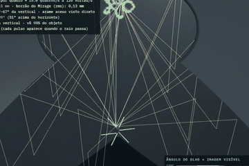
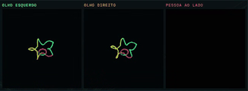
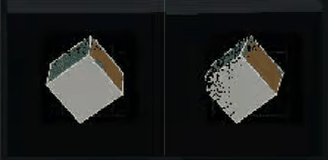
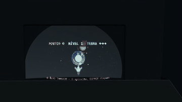
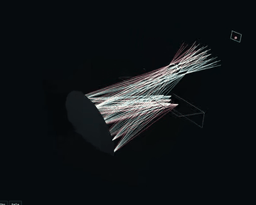

<p align="center">
  
  
  
  
  
</p>

<h1 align="center">🪞 Holosion</h1>

<table align="center">
  <tr>
    <td align="center">
      <br>
      <sub><b>🌀 Rotor de voxels</b></sub>
    </td>
    <td align="center">
      <br>
      <sub><b>🌸 Pétalas no foco</b></sub>
    </td>
    <td align="center">
      <br>
      <sub><b>👀 Um feixe por olho</b></sub>
    </td>
    <td align="center">
      <br>
      <sub><b>🎮 Console em L</b></sub>
    </td>
  </tr>
</table>

<h3 align="center">Imagem aérea 3D real a partir de um celular e um espelho côncavo</h3>

<p align="center">
  <strong>Simuladores por traçado de raios 3D: nada da imagem é desenhado — a imagem é o resultado dos raios</strong>
</p>

<p align="center">
  <a href="#-vídeos">Vídeos</a> •
  <a href="#-sobre-o-projeto">Sobre</a> •
  <a href="#-resultados-visuais">Resultados</a> •
  <a href="#-métricas">Métricas</a> •
  <a href="#️-impressão-3d">Impressão 3D</a> •
  <a href="#-uso">Uso</a> •
  <a href="#-referências">Referências</a>
</p>

---

## 🎬 Vídeos

> 🔔 **Inscreva-se no canal** e acompanhe as novidades: [Short](https://youtube.com/shorts/5B7cIvesN00) · [vídeo completo](https://youtu.be/F41QjDo_Cyk)

| Vídeo | Formato | Assistir | Arquivo |
|:---|:---|:---|:---|
| **Short** (YouTube Shorts / Reels) | 1080 × 1920, 43 s | [▶️ YouTube](https://youtube.com/shorts/5B7cIvesN00) | [`midia/holosion-short.mp4`](midia/holosion-short.mp4) |
| **Viral v6** | 1280 × 720, 85 s | [▶️ YouTube](https://youtu.be/F41QjDo_Cyk) | [`midia/holosion-viral-v6.mp4`](midia/holosion-viral-v6.mp4) |
| **Console em L** (zoom na tela, 360° com os raios, jogo) | 1280 × 720, 52 s | — | [`midia/console-L-meialua.mp4`](midia/console-L-meialua.mp4) |

<p align="center">
  <br>
  <sub>Raios traçados: tela do celular → meia-lua de espelho → imagem real no ar</sub>
</p>

Narração em português gerada por voz aberta (**Kokoro pt-BR** pelo **ComfyUI**), trilha e efeitos sintetizados por código, som real do jogo.

---

## 📖 Sobre o Projeto

O brinquedo **Mirage** usa dois espelhos parabólicos frente a frente para fazer um objeto flutuar no ar. O **Holosion** pergunta:
**dá para trocar o objeto, o motor e um dos espelhos por um único celular — e ainda ter profundidade de verdade?**

Foram **18 configurações** testadas em simuladores por traçado de raios, todas medidas com a mesma régua, inclusive as que falharam.

### 🎯 Motivação

| Ilusão comum | Holosion |
|--------------|----------|
| "Holograma" de ventilador de LED / Pepper's ghost | **imagem real** formada no ar por espelho côncavo |
| Anamorfose: dá um passo para o lado e a ilusão se desfaz | tela no **plano focal**: um feixe para cada olho, a cabeça se move e o objeto continua lá |
| Promessa de "3D perfeito" | **trilema óptico** medido: tela cheia · volume 3D · foco correto — escolha dois |

### 🧠 Conceito: Física ↔ Simulação

```
┌──────────────────────────┬─────────────────────────────────────────────┐
│ Fenômeno físico          │ No simulador                                │
├──────────────────────────┼─────────────────────────────────────────────┤
│ Raio de luz              │ reta 3D traçada contra superfícies analíticas│
│ Espelho côncavo          │ parabolóide / elipsoide / esfera exatos     │
│ Imagem real              │ convergência por mínimos quadrados dos raios│
│ O que o olho vê          │ traçado pixel a pixel a partir do olho      │
│ Paralaxe / estéreo       │ dois olhos, pupila ⌀ 4 mm, fusão dos pontos │
│ Pré-distorção do conteúdo│ mapa traçado tela → vista do olho           │
└──────────────────────────┴─────────────────────────────────────────────┘
```

---

## 📐 Arquitetura — Console em L (vídeos v6 e Short)

```
                  ┌───────────────────────────────── gabinete preto fosco (540 × 458 × 791 mm) ─┐
                  │                                                                              │
   meia-lua       │   )                       frente (z = 408 mm)                                │
   R 700 ⌀ 460 ──▶│   )  ◀──── luz da tela ─────────┤ passagem ├──── degrau do L com chanfro ─┐ │
   (vértice z = 0)│   )                             │          │      iPhone a 700 mm, tela ◀ │ │
                  │   )  ─────── reflexo ─────────▶ │  janela  │ ──▶  IMAGEM REAL NO AR       │ │
                  └──────────────────────────────────────────────────── (741 mm, 334 mm fora) ┘ │
                                                                         👁 olho a 600 mm além
```

| Parâmetro | Valor | Descrição |
|-----------|-------|-----------|
| **Espelho** | parabolóide z = r²/2R, R = 700 mm | meia-lua ⌀ 460 mm, corda em y = −40 mm |
| **Tela** | iPhone 15 Pro 6,1″ | 140,7 × 64,9 mm, no centro de curvatura (u = 700 mm) |
| **Imagem** | 142 × 65 mm, 1,01× | real, no ar, 334 mm para fora da janela |
| **Borrão que o olho vê** | 0,10 mm | pupila ⌀ 4 mm, pior ponto |
| **Distorção** | 1,8 mm → **0,0 mm** | sem / com pré-compensação traçada |
| **Janela do olho** | 100 × 80 mm | onde se vê a imagem inteira |

---

## 🎨 Resultados Visuais

| Etapa | Técnica | Resultado medido |
|-------|---------|------------------|
| 🌀 Rotor de arames no Mirage | escada helicoidal + laser pelo furo (voxels reais) | 0,28 mm rms (spot 2 mm) |
| 📺 Display no leito | tela redonda no espelho de baixo | distorção média 1 % |
| 🖥️ Tela no espelho de cima | OLED curvo, olho rastreado | 0,6 mm, vazamento 6 % |
| 🌸 Pétalas | 4 celulares no plano focal | **0,20 mm**, vazamento 0, 6 lugares a 100 % |
| 🪞 Recorte côncavo + tablet | um espelho só | imagem 199 × 128 mm a 685 mm, borrão 0,14 mm |
| 👀 Estéreo ajustado | fatia do Mirage inclinada 16° + iPhone 15 Pro | erro 0,65 mm, borrão 0,78 mm, cabeça ±75 mm |
| 🎮 Console em L | meia-lua R 700 + iPhone 15 Pro | borrão 0,10 mm, distorção 0,0 mm compensada |
| 💄 Console barato | espelho de maquiagem ⌀ 20 cm + iPhone | tela inteira 112 × 54 mm, borrão 0,29 mm, ≈ 16,6 L |

---

## 📊 Métricas

### O trilema óptico (um espelho + uma tela plana)

| Configuração | Tela cheia | Volume 3D próprio | Foco correto |
|--------------|:----------:|:-----------------:|:------------:|
| Melhor dos mundos (35/35 pontos, janela 220 × 720 mm) | ✅ | ❌ | ✅ |
| Estéreo no foco (0 % pixels em comum) | ❌ | ✅ | ❌ (2–4 D) |
| Console em L (imagem real 1:1) | ✅ | ❌ | ✅ |

```
🔬 ESTÉREO AJUSTADO (iPhone 15 Pro):
   erro de profundidade ........ 0,65 mm
   borrão ...................... 0,78 mm   (governado pelo espelho)
   pixels em comum entre olhos . 0,1 %
   movimento de cabeça ......... ±75 mm
   conflito vergência-acomodação 2 a 4 D
```

---

## 🖨️ Impressão 3D

Guia completo: **[impressao/GUIA-DE-IMPRESSAO.md](impressao/GUIA-DE-IMPRESSAO.md)** — filamento **fosco (matte)**, peças, montagem e as opções de espelho:

| # | Espelho | Situação |
|---|---------|----------|
| 1 | espelho de baixo do próprio Mirage, inteiro | melhor óptica; exige nova simulação do console L |
| 2 | ABS preto + vapor de acetona | "espelho negro", ~4 % de reflexão |
| 3 | ABS metalizado a vácuo | melhor opção impressa |
| 4 | PLA lixado + verniz + metalização | trabalhoso; linhas dominam |

**Aberração medida no traçado:** ondulação de **0,25 mrad** com período de 10 mm já leva o borrão de 0,11 para 0,45 mm e derruba de 35 para 14 os pontos visíveis — acabamento óptico é obrigatório.

---

## 🛠️ Instalação

Nenhuma. São páginas HTML autocontidas (Three.js r128 e fontes por CDN — precisa de internet).

```bash
git clone https://github.com/Diyanderson/holosion.git
cd holosion/simuladores
# abra mirage-rotor-3d.html no navegador
```

---

## 🚀 Uso

| Simulador | O que faz |
|-----------|-----------|
| [`mirage-rotor-3d.html`](simuladores/mirage-rotor-3d.html) | **principal**: rotor, display no leito, tela no espelho de cima e a aba **acessório iPhone** (`#celular`) |
| [`objeto-3d-no-leito.html`](simuladores/objeto-3d-no-leito.html) | par elipsoidal completo: objeto articulado, oclusão, cone de visão |
| [`simulador-espelhos-concavos.html`](simuladores/simulador-espelhos-concavos.html) | banco óptico 2D meridional |
| [`espelhos-3d-foco-ajustavel.html`](simuladores/espelhos-3d-foco-ajustavel.html) | par elipsoidal 3D, altura da imagem ajustável |
| [`camera-do-observador.html`](simuladores/camera-do-observador.html) | o que o olho recebe |
| [`gravura-especular-no-leito.html`](simuladores/gravura-especular-no-leito.html) | placa gravada + lâmpada (G-code/STL) |
| [`nipkow-espiral-no-leito.html`](simuladores/nipkow-espiral-no-leito.html) | imagem volumétrica programável |

Editar o acessório: [`simuladores/fonte/acessorio-celular.html`](simuladores/fonte/acessorio-celular.html) e depois `node embutir-celular.js` (copia para a 4ª aba do Mirage).
**Repetibilidade:** todo sorteio usa `mulberry32` com semente fixa e o relógio do simulador pode ser congelado — duas execuções dão o mesmo resultado.

---

## 📁 Estrutura do Repositório

```
holosion/
├── 📄 README.md
├── 📄 LICENSE
│
├── 📂 simuladores/
│   ├── 🌐 mirage-rotor-3d.html          (principal, 4 abas)
│   ├── 🌐 objeto-3d-no-leito.html … nipkow-espiral-no-leito.html
│   ├── 📂 fonte/acessorio-celular.html   (fonte da 4ª aba)
│   └── ⚙️ embutir-celular.js
│
├── 📂 3mf/
│   ├── 🏭 Console-L-meialua-iPhone.3mf
│   ├── 🏭 Console-L-maquiagem-iPhone.3mf  (espelho de maquiagem comprado)
│   ├── 🏭 Model-iphone-estereo-ajustado.3mf
│   └── 🏭 Model-esboco-do-autor.3mf
│
├── 📂 impressao/GUIA-DE-IMPRESSAO.md
├── 📂 ferramentas/                       (geradores de 3MF e conferência óptica em Python)
├── 📂 artigo/                            (IEEE, 8 páginas, PDF + LaTeX + figuras, roteiro e prompt de vídeo)
├── 📂 midia/                             (GIFs e vídeos)
└── 📂 docs/                              (especificação física e notas técnicas)
```

---

## 📚 Referências

1. **Hecht, E.** (2017). *Optics* (5th ed.). Pearson.
2. **Born, M. & Wolf, E.** (1999). *Principles of Optics* (7th ed.). Cambridge University Press.
3. **Welford, W. T.** (1986). *Aberrations of Optical Systems*. Adam Hilger.
4. **Spencer, G. H. & Murty, M. V. R. K.** (1962). General Ray-Tracing Procedure. *Journal of the Optical Society of America*.
5. **Lippmann, G.** (1908). Épreuves réversibles donnant la sensation du relief. *Journal de Physique Théorique et Appliquée*.
6. **Hoffman, D. M. et al.** (2008). Vergence–accommodation conflicts hinder visual performance and cause visual fatigue. *Journal of Vision*.
7. **Dodgson, N. A.** (2005). Autostereoscopic 3D displays. *IEEE Computer*.
8. **Jones, A. et al.** (2007). Rendering for an interactive 360° light field display. *ACM Transactions on Graphics*.

Lista completa (22 referências) em [`artigo/referencias.bib`](artigo/referencias.bib).

---

## 🎓 Contexto Acadêmico

<table>
  <tr>
    <td><b>📚 Curso</b></td>
    <td>Inteligência Artificial e Machine Learning (IAM)</td>
  </tr>
  <tr>
    <td><b>📘 Disciplina</b></td>
    <td>Inteligência Artificial Simbólica (234976)</td>
  </tr>
  <tr>
    <td><b>🏫 Instituição</b></td>
    <td>Centro Universitário Leonardo da Vinci (Uniasselvi/Vitru)</td>
  </tr>
  <tr>
    <td><b>📅 Turma</b></td>
    <td>FLD6662753CET</td>
  </tr>
  <tr>
    <td><b>📆 Data</b></td>
    <td>Novembro 2026</td>
  </tr>
</table>

---

## 👤 Autor

<table>
  <tr>
    <td align="center" width="200">
      <a href="https://github.com/Diyanderson">
        <br>
        <sub><b>Anderson Alves dos Santos</b></sub>
      </a>
    </td>
    <td>
      <b>🏥 Profissão:</b> Téc. Eletrônico/Qualidade - Engenharia Clínica @ Hospital Moinhos de Vento(10+yrs)<br>
      <b>🎓 Formação:</b> Eng. Elétrica(incomplet)-PUCRS / Eletrônica-CTPE Parobé / Impressão 3D Total/Anhanguera-Grupo Cogna<br>
      <b>📚 Formação:</b> IA & Machine Learning - Uniasselvi (andamento)<br>
      <b>📄 Publicações:</b> 3 artigos no Global Clinical Engineering Journal<br>
      <br>
      <a href="https://br.linkedin.com/in/anderson-alves-dos-santos-78048388">
        
      </a>
      <a href="https://github.com/Diyanderson">
        
      </a>
      <a href="mailto:diyanderson@gmail.com">
        
      </a>
    </td>
  </tr>
</table>

---

## 📄 Licença

Este projeto está sob a licença MIT. Veja o arquivo [LICENSE](LICENSE) para mais detalhes.

---

<p align="center">
  <sub>🪞 Desenvolvido com JavaScript + Three.js | 🔬 Nada da imagem é desenhado — tudo é traçado de raios</sub>
</p>

<p align="center">
  
  
  
</p>
